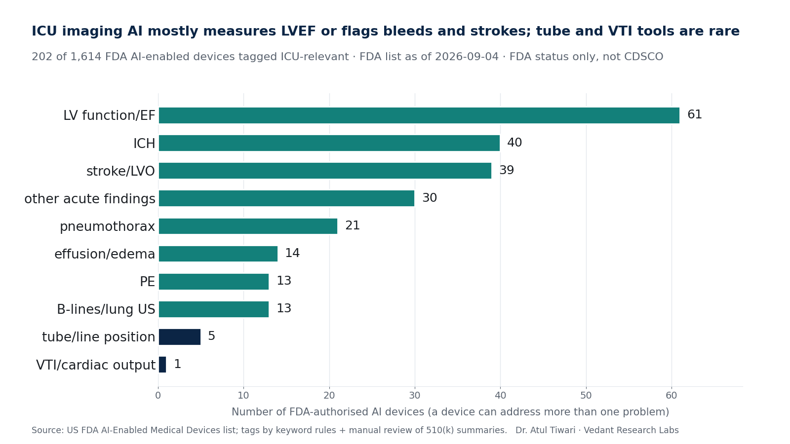

# ICU Imaging AI Atlas

A searchable list of **US FDA-authorised AI-enabled medical devices relevant to ICU imaging** (chest X-ray, CT, ultrasound/echo), tagged by modality, task and ICU problem.

**Site:** https://atultiwari.github.io/icu-imaging-ai-atlas/
**Data:** [`data/icu_imaging_ai_atlas.csv`](data/icu_imaging_ai_atlas.csv)

> **Teaching and research only — not a clinical device.**
> This is **FDA regulatory status only**. It does **not** cover CDSCO (India) or any other regulator. Being on the FDA list says nothing about how well a device works in your ICU.

Built for the lecture *AI in Imaging and Diagnostic Applications*, AI in Critical Care Workshop, CRITICARE 2027 (ISCCM, 4–7 Feb 2027).

## Counts

| | |
|---|---|
| FDA AI-enabled devices in the list (page current as of **4 Sep 2026**; latest decision 29 Jun 2026) | **1,614** |
| Tagged ICU-relevant | **202** |

**By modality:** CT 101 · ultrasound/echo 69 · CXR 32 · other 0

**By task** (a device can have several): detect/triage 122 · measure/quantify 88 · image quality 13 · guide acquisition 11 · report drafting 5

**By ICU problem** (a device can have several): LV function/EF 61 · ICH 40 · stroke/LVO 39 · other acute findings 30 · pneumothorax 21 · effusion/edema 14 · PE 13 · B-lines/lung US 13 · tube/line position 5 · VTI/cardiac output 1



## Method

1. **Source.** The FDA "List of AI-Enabled Medical Devices" CSV, downloaded 24 Oct 2026 (`data/raw/fda_ai_devices_2026-09-04.csv`, SHA-256 `b1efeb68…7880`). The list itself has no device descriptions.
2. **Summaries.** For 1,015 devices in imaging product codes or with imaging keywords, the public 510(k)/De Novo summary PDF was downloaded from accessdata.fda.gov (1,009 retrieved; 6 not available) and the *Indications for Use* text extracted (`scripts/extract_ifu.py`, excerpts in `data/derived/fda_ifu_excerpts.csv`).
3. **Keyword screen.** Rules in `scripts/tag_rules.py` tag modality, task and ICU problem from the device name + indications (`scripts/find_candidates.py`), giving 279 candidates (`data/derived/candidates_keyword_screen.csv`).
4. **Manual review.** Each candidate's name and summary were read. Decisions (49 exclusions, 13 additions the keywords missed, corrected tags, and a stricter rule for ultrasound *systems*) are recorded with reasons in `scripts/review_decisions.py`. Things the review was unsure about are in [`NOTES.md`](NOTES.md).
5. **Build.** `scripts/build_atlas.py` writes the atlas CSV; `scripts/make_deck_assets.py` writes `deck/atlas_summary.json` and the chart.

### Inclusion rule
A device is ICU-relevant if it uses CXR, CT or ultrasound/echo **and** its stated output addresses one of: tube/line position, pneumothorax, effusion/edema, intracranial haemorrhage, PE, stroke/LVO, LV function/EF, VTI/cardiac output, B-lines/lung ultrasound, or another acute finding an intensivist acts on (aortic dissection, free air, C-spine or rib fractures, midline shift, hydrocephalus). Echo acquisition-guidance software is included. Ultrasound *systems* are included only when their summary names an AI EF, VTI or B-line feature.

### Reproduce
```bash
pip install pandas matplotlib
# 1. put the FDA CSV in data/raw/; 2. download summary PDFs and run pdftotext -l 12 on each into <txt-dir>
python scripts/extract_ifu.py <txt-dir> data/derived/fda_ifu_excerpts.csv /tmp/fda_body.csv
cd scripts
python find_candidates.py ../data/raw/fda_ai_devices_2026-09-04.csv ../data/derived/fda_ifu_excerpts.csv /tmp/fda_body.csv ../data/derived/candidates_keyword_screen.csv
python build_atlas.py ../data/raw/fda_ai_devices_2026-09-04.csv ../data/derived/candidates_keyword_screen.csv ../data/derived/fda_ifu_excerpts.csv /tmp/fda_body.csv ../data/icu_imaging_ai_atlas.csv
cd .. && python scripts/make_deck_assets.py data/raw/fda_ai_devices_2026-09-04.csv data/icu_imaging_ai_atlas.csv deck/
```
The site is plain HTML/JS (`index.html`), no build step; serve the repo root (GitHub Pages: branch `main`, folder `/`).

## Limitations
- **FDA only, not CDSCO.** Indian regulatory status is not covered.
- The FDA list covers devices FDA has identified as AI-enabled; it is not exhaustive and lags new clearances (latest decision in this copy: 29 Jun 2026).
- Tags come from 510(k) summaries, which describe intended use, not real-world performance. A device on this list may not be sold in India, may not be in use, and may perform worse on supine portable ICU films than in its validation set.
- Ultrasound systems often bundle AI features their summaries do not describe; this atlas likely **under-counts** them (see NOTES.md).
- "ICU-relevant" is a judgement. Many CT triage tools (ICH, LVO, PE) are bought by radiology departments and act before the patient reaches the ICU.
- One reviewer; no second-reader agreement was measured.

## Licence and credit
Code: MIT ([LICENSE](LICENSE)). Data and figures: CC BY 4.0 ([data/LICENSE](data/LICENSE)). The underlying FDA list and summaries are US Government works in the public domain.

Credit: **Dr. Atul Tiwari · Vedant Research Labs**
